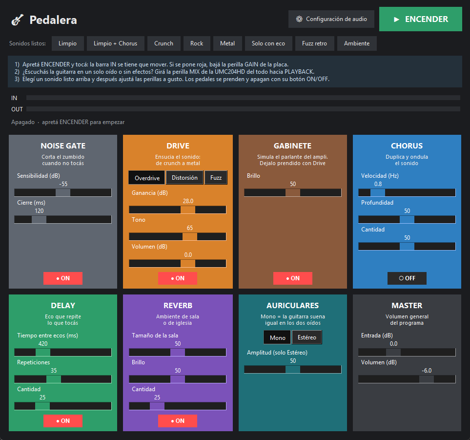

# Pedalera virtual

Pedalera de efectos para guitarra que corre en tiempo real en la PC. Conectás la guitarra a una placa de audio, abrís el programa y tocás con los efectos encendidos, igual que con una pedalera física.



## Características

- **8 pedales** con su propio interruptor ON/OFF:

  | Pedal | Qué hace |
  |---|---|
  | Noise Gate | Corta el zumbido cuando no estás tocando |
  | Drive | Overdrive, Distorsión o Fuzz, con control de ganancia, tono y volumen |
  | Gabinete | Simula el parlante de un amplificador |
  | Chorus | Duplica y ondula el sonido |
  | Delay | Eco con tiempo y cantidad de repeticiones ajustables |
  | Reverb | Ambiente de sala, basado en el algoritmo Freeverb |
  | Auriculares | Salida en mono (la guitarra en los dos oídos) o en estéreo ensanchado |
  | Master | Volumen de entrada y de salida |

- **Sonidos listos:** Limpio, Limpio + Chorus, Crunch, Rock, Metal, Solo con eco, Fuzz retro y Ambiente.
- **Baja latencia:** usa ASIO cuando está disponible. Con una Behringer UMC204HD el retraso total es de unos 10 a 15 ms.
- **Detección automática del canal** en el que está enchufada la guitarra.
- **Medidores de nivel** de entrada y salida, y un indicador del retraso, el uso de CPU y los cortes de audio.
- **Guarda tus ajustes** al cerrar el programa.

Cadena de señal:

```
Guitarra → Noise Gate → Drive → Gabinete → Chorus → Delay → Reverb → Auriculares → Master → Salida
```

## Requisitos

- Windows 10 u 11
- Python 3.10 o superior
- Una placa de audio con entrada de instrumento (probado con una Behringer UMC204HD)
- Recomendado: el driver ASIO de la placa, para tener el menor retraso posible

## Instalación

```bash
git clone https://github.com/valeneuch/pedaleravirtual.git
cd pedaleravirtual
pip install -r requirements.txt
```

## Uso

Hacé doble clic en `Pedalera.bat`, o desde la terminal:

```bash
python pedalera.py
```

1. Apretá **ENCENDER** y tocá. La barra **IN** se tiene que mover. Si se pone roja, bajá la perilla de ganancia de la placa.
2. Elegí uno de los **sonidos listos** y después ajustá las perillas a gusto.
3. Prendé y apagá cada pedal con su botón **ON/OFF**.

La configuración de audio (driver, dispositivos, canal, retraso y frecuencia de muestreo) se elige sola. Si necesitás cambiarla, está en **⚙ Configuración de audio**.

### Ajustes recomendados en la placa

- Activá el modo **INST** en el canal donde está la guitarra.
- Si la placa tiene monitoreo directo (en la UMC204HD es la perilla **MIX**), llevalo del todo hacia **PLAYBACK**. Si no, vas a escuchar también la guitarra sin efectos, normalmente en un solo oído.

## Solución de problemas

| Problema | Solución |
|---|---|
| "No se pudo abrir la placa de audio" | El programa ya probó solo otras frecuencias y drivers. El mensaje muestra qué programas abiertos pueden estar usando la placa: cerralos. Si no aparece ninguno, desenchufá y volvé a enchufar la placa y abrí de nuevo la Pedalera |
| El sonido sale entrecortado o "trabado" | Instalá el driver ASIO de la placa y elegí **ASIO** en ⚙ Configuración de audio. En notebooks, enchufá el cargador y conectá la placa directo a un puerto USB (sin hub). Si hay cortes, el programa sube el **Retraso** solo y avisa en amarillo |
| Se escuchan chasquidos sueltos | En ⚙ Configuración de audio, cambiá **Retraso** a *Bajo* o *Seguro* y dejá la **Frecuencia** en *Auto* |
| Se nota el retraso al tocar | Usá el driver **ASIO** y probá **Retraso** en *Mínimo* |
| Zumbido entre nota y nota | Subí la **Sensibilidad** del Noise Gate |
| La guitarra suena en un solo oído | Dejá el pedal Auriculares en **Mono** y revisá el monitoreo directo de la placa |

## Estructura del proyecto

```
pedalera.py        Efectos de audio e interfaz gráfica
Pedalera.bat       Acceso directo para abrir el programa en Windows
requirements.txt   Dependencias de Python
```

## Licencia

Distribuido bajo la licencia MIT. Ver [LICENSE](LICENSE).
